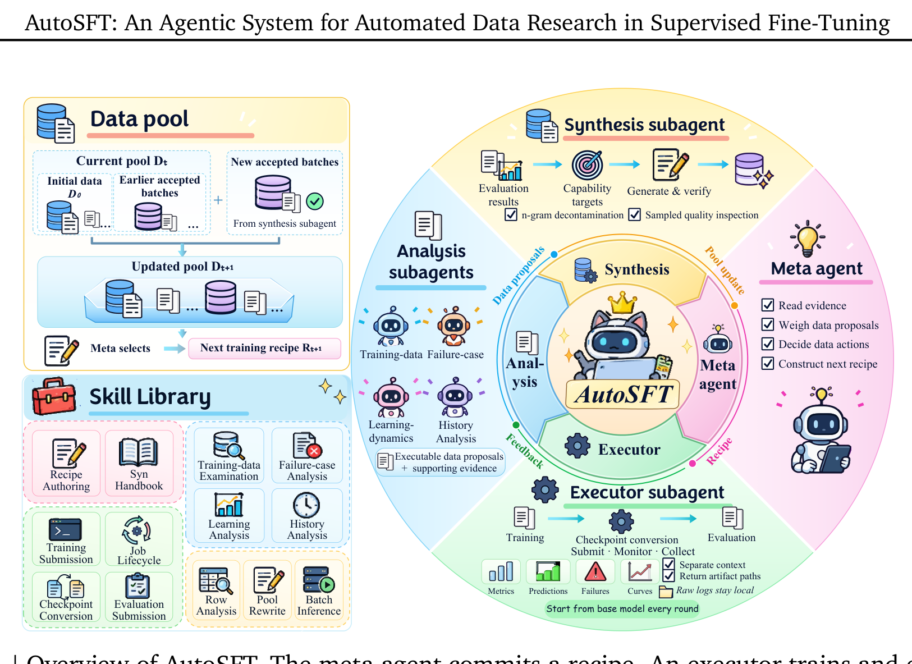

<div align="center">

# AutoSFT: An Agentic System for Automated Data Research<br>in Supervised Fine-Tuning

[](https://arxiv.org/pdf/2610.22194) [](https://github.com/Thinking-Space/AutoSFT) [](https://huggingface.co/papers/2610.22194) [](https://x.com/HBX_hbx/status/2110969562271482355)

</div>

<div align="center">
  <p>
    <a href="#news">🎉 News</a> •
    <a href="#overview">📖 Overview</a> •
    <a href="#getting-started">✨ Getting Started</a> •
    <a href="#paper-results">📊 Paper Results</a> •
    <a href="#citation">🎈 Citation</a>
  </p>
</div>

---

<a id="news"></a>

## 🎉 News

- Our [AutoSFT paper](https://arxiv.org/pdf/2610.22194) is available on arXiv. See the [Hugging Face Daily Paper](https://huggingface.co/papers/2610.22194) and our [X thread](https://x.com/HBX_hbx/status/2110969562271482355) for discussion.

<a id="overview"></a>

## 📖 Overview



AutoSFT is the first implementation of **RSI-Service**, a research service between a human objective and the code that trains AI. A user states a goal and a resource limit; agents prepare data, run experiments, inspect evidence and decide what to try next. This study focuses on SFT data research while keeping the base model, training algorithm and evaluation protocol fixed. The service is organized so further optimization domains can share its objectives, task lifecycle and experiment history.

The meta agent owns the data decision. An executor handles training, checkpoint conversion and evaluation in a separate context. Four analysis subagents examine training data, failure cases, learning dynamics and research history, each returning an executable proposal. A synthesis subagent creates supervision for undersupplied capabilities. These components are independently configurable, and every normal training round starts from the same base model.

Our empirical study finds that an unstructured agent explores little of the available data space and often overattributes score changes to its latest intervention. Separating execution from research and adding complementary analysis improves its behavior, while synthesis helps some capabilities and remains uneven on code. The paper's six data-action families are retrospective labels for analyzing realized changes; they are not an operator menu injected into the agent.

<a id="getting-started"></a>

## ✨ Getting Started

### Environment Setup

Activate a Python environment with a PyTorch/CUDA build selected for your GPU
and driver. Install Transformer Engine with the pinned Megatron checkout's
requirement `>=2.6.0a0,<2.8.0`, and install FlashAttention against that exact
same PyTorch/CUDA ABI. Verify `torch`, `transformer_engine.pytorch` and
`flash_attn` import before installing the Python requirements:

```bash
python - <<'PY'
import torch, transformer_engine.pytorch, flash_attn
print(torch.__version__, torch.version.cuda, torch.cuda.is_available())
print("native training extensions imported")
PY
```

Then install the training dependencies from `scripts/local/requirements-train.txt`. For evaluation, install a vLLM-supported PyTorch/CUDA pair first in a dedicated environment, then install `scripts/local/requirements-eval.txt`; that file pins vLLM and Transformers but cannot select the correct native ABI for every GPU or PyTorch build. AutoSFT uses the active Python for data preparation, training and conversion by default; evaluation can use a separate interpreter when vLLM needs a different PyTorch build. Follow [runtime setup](docs/local-runtime.md) before installing native dependencies. The paper uses Qwen3-1.7B-Base and eight NVIDIA H800 GPUs for training, with one H800 for evaluation.

```bash
pip install -e .
pip install -r scripts/local/requirements-train.txt
cp .env.example .env
```

Fill `.env` with your local model paths and your own API settings. The Hugging Face base-model directory contains its weights, config and tokenizer together; the Megatron checkpoint is imported from that model once. Load `.env` when using standalone preparation or checking commands:

```bash
set -a
source .env
set +a
```

Download the base model with a Hugging Face client, or copy the complete directory from an offline machine. For example:

```bash
hf download Qwen/Qwen3-1.7B-Base --local-dir /path/to/Qwen3-1.7B-Base
export AUTO_SFT_SFT_TOKENIZER_MODEL=/path/to/Qwen3-1.7B-Base
```

The directory must include the model configuration, tokenizer files and all weight shards. Keep the Megatron checkpoint in a separate directory; do not point both variables at the same directory.

The **research agents** (meta, executor and analysis) use your authenticated Codex CLI. The **data-processing model** uses `AUTO_SFT_LLM_BASE_URL`, `AUTO_SFT_LLM_MODEL` and `AUTO_SFT_LLM_API_KEY` for operations such as rewriting and quality checks. **Synthesis** uses the same `AUTO_SFT_LLM_BASE_URL`, `AUTO_SFT_LLM_MODEL` and `AUTO_SFT_LLM_API_KEY` provider as data processing. See [model configuration](docs/model-provider.md) for their roles.

Fetch the public Megatron source pinned to `core_v0.14.0` at commit `23e00ed0963c35382dfe8a5a94fb3cda4d21e133`, then import your base model:

```bash
python scripts/setup/fetch_megatron.py
python -m autosft.backends.megatron.import_model \
  --model "$AUTO_SFT_SFT_TOKENIZER_MODEL" --output "$AUTO_SFT_SFT_BASE_CKPT"
```

If you downloaded Megatron separately (for example, on a machine without GitHub access), set the checkout override instead of fetching it into `third_party`:

```bash
export AUTO_SFT_MEGATRON_DIR=/path/to/Megatron-LM-23e00ed0963c35382dfe8a5a94fb3cda4d21e133
test -f "$AUTO_SFT_MEGATRON_DIR/pretrain_gpt.py"
```

### Data Preparation

Download and normalize the paper's four public training sources:

```bash
autosft datasets --pool instruction_following --output data/pools/instruction_following
autosft datasets --pool code --output data/pools/code
```

The instruction-following pool uses `argilla/ifeval-like-data`. The code pool combines `OpenCoder-LLM/opc-sft-stage2`, `KodCode/KodCode-V1-SFT-R1` and `ise-uiuc/Magicoder-OSS-Instruct-75K`. Source manifests record revisions, filters, actual row counts and file hashes. See [data preparation](docs/data.md) for revision selection, the ChatML input format and synthesis checks.

### Run an Experiment

Inspect a resolved protocol, then launch its agent run:

```bash
bash scripts/run.sh --config configs/paper/analysis.json --dry-run
bash scripts/run.sh --config configs/paper/analysis.json
```

The launcher loads `.env`, stages the pool and starts the controller. The controller runs the meta agent, launches the enabled roles, supervises training and evaluation, and resumes the same sessions after interruptions. Read [the complete agent run](docs/agent-run.md) for the entrypoint, prompt assembly, per-round execution, artifacts and recovery commands.

<details>
<summary><b>Experiment Configuration</b></summary>

| Block | Paper setting | Purpose |
| --- | --- | --- |
| `objective` | Natural-language goal and benchmark targets | Defines what the research should achieve |
| `components` | `executor`, `analysis`, `synthesis` | Selects independent subagent components; `[]` is the baseline |
| `resources` | Token cap, maximum rounds, eight training GPUs | Bounds the experiment |
| `training` | Qwen3-1.7B-Base, three epochs, Adam, cosine decay | Fixes the training protocol |
| `evaluation` | Temperature 0.7, zero-shot, benchmark-specific repeats | Fixes generation and scoring |
| `data` | Local prepared instruction-following or Python pool | Selects the source data |
| `agent` | GPT-5.5, medium reasoning effort | Configures the research agent |
| `providers` | DeepSeek V4 Flash | Configures the data-generation model |

Named presets in [configs/paper](configs/paper) bind Table 5/6 settings. A run writes its resolved protocol to `experiment.json`. See [configuration](docs/configuration.md) for the complete mapping and local runtime settings. The usual commands are `autosft datasets`, `autosft run` and `autosft check`; `autosft round` runs a single round without agents. Individual training, conversion, evaluation and recovery tools are grouped under `autosft tools`.

</details>

### Component Ablations

Compare components under the same protocol with one launch override:

```bash
bash scripts/run.sh --config configs/paper/analysis.json --components none
bash scripts/run.sh --config configs/paper/analysis.json --components executor
bash scripts/run.sh --config configs/paper/analysis.json --components executor,analysis
```

Run the synthesis comparison with `configs/paper/synthesis-baseline.json` and `configs/paper/synthesis.json`. Code presets are `code-baseline.json`, `code-analysis.json` and `code-synthesis.json`. Enabling synthesis leaves the executor and analysis selections independent.

### Validate the Pipeline

Check source assets before launching an experiment:

```bash
autosft check --agents --synthesis
```

For a bounded agent check using the bundled pool, run:

```bash
bash scripts/run.sh --config configs/examples/smoke-agent.json
```

This uses one training GPU and at most two rounds. See [the validation procedure](docs/agent-run.md#a-bounded-agent-validation-run) for expected artifacts, terminal status and adding synthesis.

With local weights and workload environments configured, check the runtimes:

```bash
autosft check --runtime --gpu --agents --synthesis \
  --model "$AUTO_SFT_SFT_TOKENIZER_MODEL" \
  --checkpoint "$AUTO_SFT_SFT_BASE_CKPT"
```

This check must pass for the stages you intend to run. A native error such as `vllm/_C.abi3.so: undefined symbol` means the vLLM/PyTorch/CUDA binaries are incompatible; use the separate evaluation environment described in [runtime setup](docs/local-runtime.md) and rerun the check.

<details>
<summary><b>One Training Round Without Agents</b></summary>

The included [smoke dataset](examples/smoke_train.jsonl) contains four small ChatML conversations. Use it to check preparation, base-checkpoint import, training, conversion and evaluation before testing the agent loop. The output directory must be new.

```bash
autosft round \
  --data examples/smoke_train.jsonl \
  --model "$AUTO_SFT_SFT_TOKENIZER_MODEL" --output /path/to/new-smoke-round \
  --token-budget 3000000 --gpus 1 --context-parallel 1 \
  --global-batch-size 4 --seq-length 128 \
  --benchmarks ifeval --eval-repeats 1 --eval-limit 4 \
  --eval-max-seq-len 2048 --eval-max-out-len 128
```

`round.json` records every stage and writes `status: complete` when the pipeline finishes. Inspect the corresponding stage log on failure. These shortened evaluations are for pipeline checks; use the paper presets for benchmark experiments.

</details>

<a id="paper-results"></a>

## 📊 Paper Results

| Comparison | Metric | Without component | With component |
| --- | --- | ---: | ---: |
| Analysis, equal first 30 rounds | IFEval | 60.60 | 67.10 |
| Synthesis | IFEval | 78.15 | 81.58 |
| Synthesis | IFBench | 49.02 | 51.95 |
| Analysis on code | MBPP+ | 61.11 | 65.78 |
| Synthesis on code, added after analysis | MBPP+ | 65.78 | 64.81 |

The executor reduces meta-agent compactions from ten to five over the compared snapshots. The analysis baseline reaches 62.35 when extended to 50 rounds; the first row compares both runs' first 30 rounds. These numbers are reported by the paper. The repository provides the experiment protocols; original search traces and exact data snapshots are not bundled.

Supported benchmarks are `ifeval`, `ifbench`, `humaneval_plus` and `mbpp_plus`. Paper presets use local vLLM generation with OpenCompass instruction-following scorers or EvalPlus code scoring. Custom code experiments can select SGLang through the evaluation block.

See [architecture](docs/architecture.md), [the experiment contract](AGENTS.md) and [the skill catalog](skills/README.md) for implementation boundaries and role procedures.

<a id="citation"></a>

## 🎈 Citation

If you find this work helpful, please cite us:

```bibtex
@article{he2026autosft,
  title={AutoSFT: An Agentic System for Automated Data Research in Supervised Fine-Tuning},
  author={He, Bingxiang and Sun, Pengqi and Peng, Shihao and Li, Shaoxuan and Xiao, Huiyu and Shi, Hongjian and Fu, Zixuan and Qiao, Ziqing and Zuo, Yuxin and Qian, Cheng and others},
  journal={arXiv preprint arXiv:2610.22194},
  year={2026}
}
```

AutoSFT is released under the [MIT License](LICENSE). Third-party components retain their upstream licenses.
