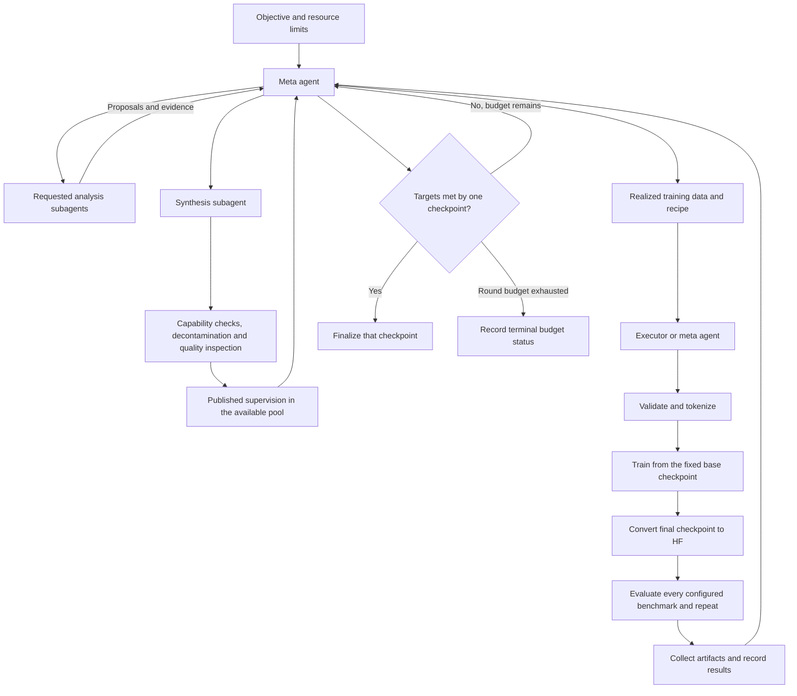

# A complete agent run

Start an experiment from the checkout with `bash scripts/run.sh --config configs/paper/analysis.json`. This is the human entrypoint. It loads `.env`, resolves the protocol and hands one experiment to the controller. The controller owns session startup, task polling and recovery; the meta agent owns research decisions.

## Before launching

Install the package with `pip install -e .`. Prepare a compatible public Megatron checkout, local Qwen3-1.7B-Base HF assets, the imported base checkpoint and the active environment described in [runtime setup](local-runtime.md). Download the selected source pool with `autosft datasets`; its path is bound by the experiment's `data.pool` block. Authenticate your Codex CLI and fill the provider settings in `.env`.

Load `.env` and check the actual environments before starting agent sessions:

```bash
set -a
source .env
set +a
autosft check --runtime --gpu --agents --synthesis \
  --model "$AUTO_SFT_SFT_TOKENIZER_MODEL" \
  --checkpoint "$AUTO_SFT_SFT_BASE_CKPT"
bash scripts/run.sh --config configs/paper/analysis.json --dry-run
```

The runtime check uses the configured training, conversion, tokenizer and evaluation interpreters. Agent and synthesis transports are checked in the controller interpreter. The Megatron check uses `AUTO_SFT_MEGATRON_DIR` when supplied, otherwise `third_party/megatron`. `--dry-run` resolves configuration and performs no model calls or submissions.

## Startup and prompt assembly

| Step | Implementation | What happens |
| --- | --- | --- |
| Load local settings | `scripts/run.sh` | Loads the ignored `.env` and invokes `python -m autosft run` |
| Resolve the experiment | `autosft.config.experiments` | Merges named configuration blocks, validates the protocol and binds runtime settings |
| Prepare the run | `scripts/agents/launch.sh` | Validates assets, creates a run directory, stages the pool, writes `experiment.json` and owner-only `task.env` |
| Start the controller | Generated `agent_runner.sh` | Loads that run's environment, records the policy baseline and invokes `autosft.agents.runner meta` |
| Start or resume research | `scripts/agents/run_codex.sh` | Executes the meta agent with the configured model and reasoning effort, using its pinned session id |

The run directory is under `runs/<configuration-name>/meta_<benchmark-set>_<timestamp>/`. The launcher prints its location and writes the controller log to `logs/agent.log`. `agent.pid` identifies the controller, while the run's separate session metadata identifies the meta-agent conversation.

The meta prompt begins with `src/autosft/agents/prompts/meta.md`, followed by the natural-language objective, target scores and the enabled component instructions. These fragments guide the meta agent's use of subagents; each subagent receives its own instructions and context.

| Recipient | Instructions loaded |
| --- | --- |
| Meta agent | `agents/prompts/meta.md`; enabled `meta_executor.md`, `meta_analysis.md`, `meta_synthesis.md`; when `executor` is disabled, also `skills/executor/{training-submission,job-lifecycle,checkpoint-conversion,evaluation-submission}/SKILL.md`; run-specific continuation evidence |
| Executor | `agents/prompts/executor.md` plus the meta-authored `executor.task_context.md` |
| Training-data analysis | `agents/prompts/analysis.md`, `skills/analysis/training-data/SKILL.md`, task report contract and pinned task inputs |
| Failure-case analysis | Same shared contract with `skills/analysis/failure-case/SKILL.md` |
| Learning-dynamics analysis | Same shared contract with `skills/analysis/learning-dynamics/SKILL.md` |
| History analysis | Same shared contract with `skills/analysis/history/SKILL.md` |
| Synthesis subagent | `synthesis/_internal/prompts/synthesis_worker.md`, `skills/synthesis/batch-generation/SKILL.md` and frozen target materials |
| Synthesis experience maintenance | `synthesis/_internal/prompts/experience_maintainer.md` and accepted delivery/usage evidence |

Prompt paths above are relative to `src/autosft/` unless they begin with `skills/`. Analysis roles load their role skill directly; the launcher adds the shared contract once. The shared `skills/shared/row-analysis` and `skills/shared/pool-rewrite` operators are available to analysis agents for task-local measurements and candidate rewrites, and to the meta agent for the final data decision. They are read on demand and are not automatically appended to every analysis prompt. Analysis agents cannot modify the shared pool or formal training data. The synthesis worker's calls use the recorded batch runner under `skills/synthesis/batch-generation`; the shared recorded-call reference under `skills/shared/batch-inference/references/recorded-calls.md` also documents the common transport used by Meta and Analysis. Runtime implementations live in the package.

## One research round



The meta agent inspects the staged pool and this run's existing evidence. With analysis enabled, it requests task-specific proposals using immutable input references. The controller runs requested tasks through `autosft.agents.search_tasks`; each task has its own Codex session, report and receipt. At bootstrap there are no trained-model failures or loss curves, so those roles must state the missing evidence.

With synthesis enabled, the meta agent consults `skills/meta/synthesis-handbook/SKILL.md` and requests supervision for identified supply gaps through `autosft.synthesis.job`. The supervisor freezes target materials and starts isolated synthesis sessions. The worker's generation, review and repair calls use the recorded batch runner in `autosft.backends.providers.batch`. Recorded row analysis, rewriting and quality review use the same recorded runner. Accepted deliveries become selectable pool data after validation, n-gram decontamination and an independent sampled quality review. The meta agent decides whether to train on them.

The meta agent writes `data_rounds/round_<n>/final_data.jsonl` and its canonical `data-recipe.yaml`, recording the hypothesis and intended comparison. Preparation validates the full data, provenance and token cap. Training iterations follow the fixed three-epoch protocol and realized token count. Every normal round initializes from the configured base checkpoint.

If the executor is enabled, the meta agent writes `role_io/round_<n>/executor.task_context.md` and refreshes `executor_handoff.json`. The controller delegates that lifecycle through `scripts/agents/run_role.sh`. The prompt and its two input readers share one context delimiter from `autosft.agents.roles`; context hashes bind reports and resumed sessions to the work they consumed. If the executor is disabled, the meta agent performs the same workload commands itself.

| Stage | Public command or owning implementation | Result |
| --- | --- | --- |
| Prepare and submit training | `autosft tools train` → data preparation → `autosft.backends.local.submission` | Token arrays, frozen recipe, submission receipt and training task |
| Execute training | `scripts/local/train_megatron.sh` → `autosft.backends.megatron.sft` | Checkpoints and TensorBoard events under `sft/round_<n>/` |
| Observe and collect training | `autosft tools jobs sft status` / `autosft tools jobs sft collect` | Actual task state, loss artifacts and `sft_final_status.json` |
| Convert the final checkpoint | `autosft tools convert` | HF model assets and a conversion manifest bound to the source checkpoint |
| Submit evaluation | `autosft tools evaluate` → local submission | One task per benchmark covering all of its repeats |
| Execute evaluation | `autosft.backends.local.evaluation.dispatch` | vLLM instruction-following or EvalPlus code artifacts |
| Observe and collect evaluation | `autosft tools jobs eval status` / `autosft tools jobs eval collect` | Complete repeat aggregates and ledger results |

The local task supervisor records host, boot id, PID and process start time. A GPU lock serializes training and benchmark workloads. A checkpoint marker does not establish that its task has finished. Collection retains terminal receipts, verifies artifacts and records an evaluation only after every required repeat is complete. An executor returns artifact paths and a short report; the meta agent interprets scores and decides the next data change.

## Artifacts to inspect

| Path under the run | Meaning |
| --- | --- |
| `experiment.json`, `task.env` | Resolved protocol and fixed local runtime settings |
| `logs/agent.log` | Controller startup, delegation, polling and terminal decisions |
| `agent_attempts.jsonl`, `meta_agent_session.json` | Meta-agent attempts and pinned conversation identity |
| `data_pool/staging_manifest.json` | Staged source identities, counts and hashes |
| `data_rounds/round_<n>/` | Formal dataset and recipe for that round |
| `role_io/round_<n>/tasks/<task-id>/` | Analysis requests, pinned inputs, session events and canonical reports |
| `role_io/round_<n>/executor.*`, `executor_reports/` | Executor prompt, context identity, session events, receipts and reports |
| `sft_submissions.jsonl`, `local_tasks/` | Training submissions and durable supervisor receipts |
| `sft/round_<n>/` | Training log, checkpoint and loss artifacts |
| `eval_runs/round_<n>/` | Evaluation request, submissions, task events, per-repeat results and aggregate scores |
| `synthesis/`, `syn_data_source/`, `synthesis_inspections/` | Synthesis attempts, published data, usage and acceptance evidence |
| `iterations.jsonl`, `recipe_history/`, `experiment_memory.json` | Measured results, immutable submitted recipes and recovery context |
| `agent_terminal_status.json`, `final_model_summary.json` | Why the controller stopped and the selected final checkpoint |

A completed run requires one checkpoint meeting every configured target with complete evaluations and matching finalization. `round_budget_exhausted` means the search reached its round cap without satisfying that condition. Scores from different checkpoints do not combine into a successful final model.

## Recovery and operator commands

A closed launching terminal does not stop the controller. Read its log before restarting. To resume after the controller has exited, run the same run-local launcher; it retains the fixed environment and pinned sessions:

```bash
bash /path/to/run/agent_runner.sh
```

The controller's run lock rejects concurrent controllers. Keep the checkout fixed while resuming; code and prompt drift are checked against the original baseline. Existing task ids and receipts are recovered before any retry. A failed evaluation can be explicitly replaced through `autosft tools evaluate --retry-failed-task`, preserving its checkpoint and protocol. Do not replace a live or ambiguous task.

Meta session discovery uses the root command's top-level `thread.started` events
in `logs/agent.log`. Preserve that log together with `meta_agent_session.json` and
the run's Codex history. Synthesis and experience workers can create newer
sessions in the same history, so the controller must not select a meta session
by its timestamp. Conflicting identities or ambiguous legacy history stop
recovery with an error rather than selecting another conversation.

For manual inspection or collection, load the run's environment first:

```bash
set -a
source /path/to/run/task.env
set +a
autosft tools jobs sft status
autosft tools jobs sft collect
AUTO_SFT_EVAL_MANIFEST="$AUTO_SFT_RUN_DIR/eval_runs/round_1/eval_submissions.jsonl" autosft tools jobs eval status
AUTO_SFT_EVAL_MANIFEST="$AUTO_SFT_RUN_DIR/eval_runs/round_1/eval_submissions.jsonl" autosft tools jobs eval collect
```

`autosft tools jobs sft stop <task-id>` and `autosft tools jobs eval stop <task-id>` stop only tasks belonging to the selected manifest. `autosft tools evaluate-round <checkpoints-dir>` retains the manual workflow for converting and evaluating one completed round. The agent's executor uses separate conversion and evaluation stages so each is recoverable.

Start a new run for a changed objective, component composition or training/evaluation protocol. For your first hardware check, use the four-row standalone smoke round in the README, then launch the chosen agent preset and inspect its first complete training/evaluation cycle.

## A bounded agent validation run

`configs/examples/smoke-agent.json` uses the bundled four-row pool, one training GPU, sequence length 128, a 4,096-token cap and at most two rounds. It keeps full IFEval input coverage, with one evaluation repeat and a 128-token output cap. This checks the actual meta/executor/analysis loop without downloading a training pool or starting a long paper search:

```bash
bash scripts/run.sh --config configs/examples/smoke-agent.json --dry-run
bash scripts/run.sh --config configs/examples/smoke-agent.json
```

Inspect `sft_final_status.json`, `eval_runs/round_<n>/eval_final_status.json` and the ledger to confirm complete workload cycles. Its IFEval target is deliberately high; reaching the two-round cap can end in `round_budget_exhausted` while both workload cycles succeeded. The shortened output cap and toy training set make its scores unsuitable for the paper results.

To include the synthesis component in that validation, reduce its batch size before launching:

```bash
AUTO_SFT_SYN_ROWS_PER_TARGET=8 bash scripts/run.sh \
  --config configs/examples/smoke-agent.json \
  --components executor,analysis,synthesis
```

This additionally exercises the configured provider, synthesis sessions, decontamination, quality review and published-data usage whenever the meta agent identifies a supply gap and selects the delivered rows.

For an integration check that explicitly asks for all four analysis reports and
accepted synthesis rows in the second training round, use the dedicated preset:

```bash
AUTO_SFT_SYN_ROWS_PER_TARGET=8 AUTO_SFT_SYN_WORKER_CONCURRENCY=2 \
  bash scripts/run.sh --config configs/examples/smoke-synthesis.json
```

It inherits the same small training and evaluation protocol. Verify both the
published delivery receipt and confirmed training usage under `syn_data_source`,
along with both rounds' training and evaluation receipts. Enabling the component
alone does not establish that generated rows were used. Local values in `.env`
are loaded by `scripts/run.sh` and take precedence over inline environment values
when that file assigns the same setting.
