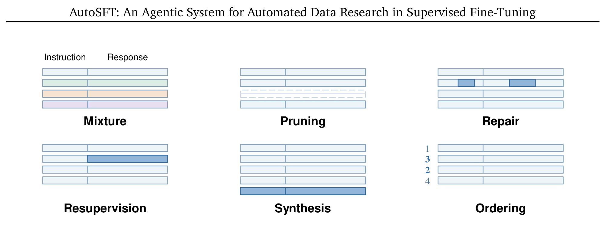

# Data preparation

The paper uses four public sources. The instruction-following pool comes from `argilla/ifeval-like-data`. The Python pool combines `OpenCoder-LLM/opc-sft-stage2`, `KodCode/KodCode-V1-SFT-R1` and `ise-uiuc/Magicoder-OSS-Instruct-75K`.

```bash
pip install -e .
autosft datasets --pool instruction_following --output data/pools/instruction_following
autosft datasets --pool code --output data/pools/code
```

The downloader resolves each source revision to a commit, reads the train split of each configuration, normalizes instruction/response pairs to ChatML and writes a source manifest with row counts and the output hash. Python selection uses explicit language metadata when present, otherwise Python-labelled code blocks or a parseable plain Python response. Exact duplicate conversations are removed within each source unless `--no-dedup` is supplied. Rows retain source dataset, revision, configuration, split, source-row identity and other source metadata. Completed files are reused only when their hashes and filters match, allowing interrupted downloads to resume. Fix individual source revisions with repeatable `--revision opc=COMMIT`, `--revision kodcode=COMMIT` and `--revision magicoder=COMMIT` arguments.

These are transparent preparation defaults. The paper reports 742,842 Python pairs; an exact reconstruction requires its source revisions and filtering rules. Download manifests record what the script actually produced and do not claim equality with the paper's original pool snapshot. HF download caches stay outside Git, and prepared pools live under the ignored `data/` directory. Dataset licenses remain those of their respective publishers.

## Training input

The trainer accepts one ChatML conversation per JSONL line. Each conversation has string `role` and `content` values and a non-empty assistant response. Use `examples/smoke_train.jsonl` to check execution, then replace it with real data. Preparation validates every row, records prepared token counts and applies the run's token cap. Sampling, duplication and ordering are expressed by the realized dataset rather than a prescribed action menu.

## Synthesis checks

The synthesis worker validates each example against its capability requirements. Before publication, the supervisor checks normalized word n-gram overlap against the selected local benchmark sets and obtains an independent model review of a deterministic sample. The default is 13-grams and up to 32 sampled rows; these are implementation defaults because the paper does not specify an overlap length or sample size. The accepted sample must have complete positive verdicts with reasons, and every inspection is bound to the delivery hash.

```bash
autosft tools decontaminate --data candidates.jsonl --benchmarks ifeval ifbench --n 13 --report overlap.json --output clean.jsonl
```

N-gram checking catches verbatim overlap after Unicode normalization and case folding. It does not establish absence of paraphrased contamination. Reports retain reference hashes and rejected row indices without copying benchmark answers into the worker's context.

## Retrospective action analysis



Mixture, pruning, repair, resupervision, synthesis and ordering are the paper's six labels for changes to the realized data. They are defined for post-run analysis, are not supplied to agents as an action menu, and do not constrain the recipe. A round may receive multiple labels. Use recipe differences and materialized training rows as evidence, rather than inferring labels only from the agent's stated rationale.

```bash
autosft tools annotate --run-dir runs/my-run --round-id 2 --labels repair mixture --evidence runs/my-run/data_rounds/round_2/final_data.jsonl --note 'Instruction and response edits plus a changed category mixture.'
```

Annotations are written separately to `reports/action_annotations.jsonl` and are not injected into research prompts or used as submission gates. Research-only changes that leave the training data unchanged do not receive data-action labels.
